# PRINCE spatial transcriptomics: figures and legends

Main Figures 1–6, Extended Data Figures 1–10 and Supplementary Figures 1–6, each followed by its legend. Figures are regenerated by `run_pipeline.sh` (final numbering applied by `tools/assemble_figures_and_tables.sh`); vector PDF and PNG versions are in `figures/`, and the Supplementary Tables and Data in `supplementary/`.

## Main figures

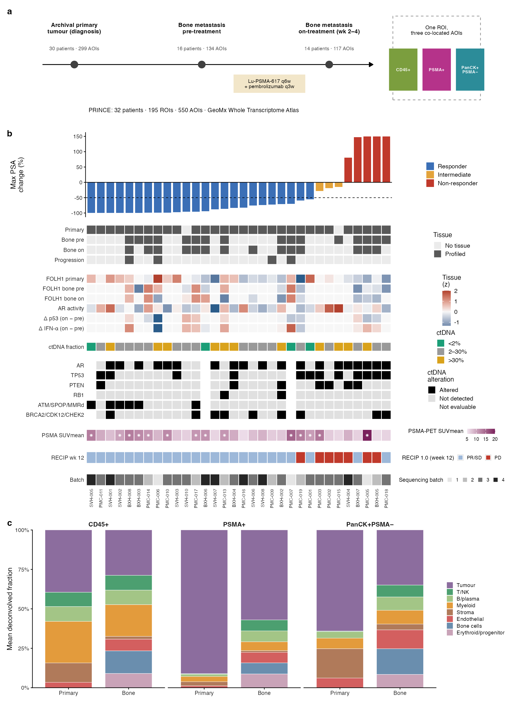

**Fig. 1 | Cohort and per-patient clinical, genomic and tissue landscape of PRINCE.** **a**, Study design. Archival primary tumours (diagnosis) and bone metastases biopsied before and 2–4 weeks after the first dose of Lu-PSMA-617 (every 6 weeks) plus pembrolizumab (every 3 weeks) were profiled with the GeoMx Whole Transcriptome Atlas (WTA; 32 patients, 195 regions of interest (ROIs), 550 areas of illumination (AOIs)). Each ROI was segmented into co-located CD45⁺ (immune), PSMA⁺ (PSMA-expressing tumour) and PanCK⁺PSMA⁻ (PSMA-negative epithelium) AOIs; numbers of patients and AOIs per timepoint are shown. **b**, The 32 patients ordered by maximal PSA change from baseline (dashed line, −50%), coloured by response group (blue, responder; amber, intermediate; red, non-responder; responder, PSA change −55% to −100%; intermediate, −15% to −28%; non-responder, +81% to +460%). PSA increases above +150% are displayed at +150% (display only); analyses used maximal PSA change capped at +100%. Tracks below show, for each patient: tissue profiled at each timepoint (dark grey) and at progression; patient-level tissue *FOLH1* (the gene encoding PSMA) in the primary tumour and in pre- and on-treatment bone, baseline androgen-receptor (AR) activity (Hallmark androgen response) and paired on-treatment change in p53 and interferon-α programmes (z-scores across patients; blank, no tissue); baseline circulating tumour DNA (ctDNA) fraction in the TheraP categories (<2%, 2–30%, >30%); ctDNA alterations (black, altered; light grey, not detected; blank, not evaluable); baseline PSMA-PET SUVmean (colour scale, 5–20; *, SUVmean ≥10); RECIP 1.0 response at week 12 (PD, progressive disease; PR/SD, partial response or stable disease); and sequencing batch (1–4). **c**, Mean cell-type composition of each compartment in primary tumour and bone, estimated by SpatialDecon with tissue-matched single-cell references (PCCAT primary prostate cancer atlas for primary tumours; GSE143791 bone-metastasis cells plus PCCAT castration-resistant tumour cells for bone).

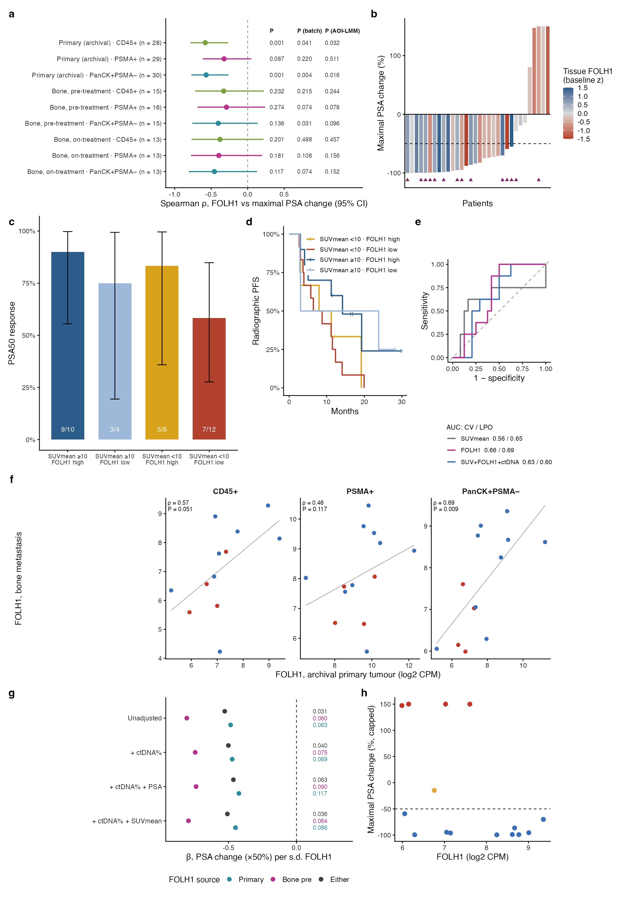

**Fig. 2 | Lower lesional PSMA (*FOLH1*) expression accompanies poorer response, is set early and adds to PSMA-PET.** **a**, Spearman correlation (dot; bar, 95% confidence interval) between patient-level *FOLH1* (summed-count pseudobulk, log₂ counts per million (CPM)) and maximal PSA change in each of the nine compartment × timepoint strata (colour, compartment: green, CD45⁺; magenta, PSMA⁺; teal, PanCK⁺PSMA⁻; n, patients per stratum, shown in each label). Columns give the unadjusted P, the P after adjustment for sequencing batch and the patient-permutation P of an AOI-level linear mixed model (*FOLH1* ~ PSA change + batch + (1 | patient); AOI-LMM). Negative ρ indicates lower *FOLH1* with worse response. **b**, Waterfall plot of maximal PSA change (dashed line, −50%) for each patient with baseline tissue, coloured by baseline tissue *FOLH1* (mean z-score over the available primary and pre-treatment bone tumour compartments; blue, higher; red, lower); triangles mark patients with baseline PSMA-PET SUVmean ≥10. PSA increases above +150% are displayed at +150% (display only); analyses used maximal PSA change capped at +100%. **c**, PSA50 response rate (≥50% PSA decline) in four groups defined by PSMA-PET SUVmean (≥10 versus <10) and tissue *FOLH1* (above versus below the cohort median), in the 32 patients with both measures; bars, exact (Clopper–Pearson) 95% confidence intervals; numbers, PSA50 responders/patients. **d**, Kaplan–Meier estimates of radiographic progression-free survival (rPFS) for the four groups in **c** (crosses, censored). Median rPFS was 14 months for SUVmean ≥10 with high *FOLH1*, 13 months for SUVmean ≥10 with low *FOLH1*, 10 months for SUVmean <10 with high *FOLH1* and 8 months for SUVmean <10 with low *FOLH1*. **e**, Receiver operating characteristic curves for predicting PSA50 failure (8 of 32 evaluable patients with baseline tissue *FOLH1* and PSMA-PET) from out-of-fold predicted probabilities of logistic models using SUVmean alone (grey), tissue *FOLH1* alone (magenta) or SUVmean, *FOLH1* and ctDNA fraction together (blue). Areas under the curve (key below the panel) are given as the mean over 50 repeats of stratified four-fold cross-validation (CV) and by leave-pair-out (LPO) validation; dashed diagonal, chance. **f**, *FOLH1* (log₂ CPM) in the archival primary tumour versus the matched pre-treatment bone metastasis, per compartment; each point is a patient coloured by response group (blue, responder; amber, intermediate; red, non-responder); line, least-squares fit; Spearman ρ and P shown. **g**, Change in maximal PSA change (in units of 50 percentage points) per s.d. of tissue *FOLH1* measured in the primary tumour (teal), pre-treatment bone (magenta) or either source (black), from linear models that were unadjusted or adjusted for log ctDNA fraction alone, with log baseline PSA, or with PSMA SUVmean; P values are shown beside each estimate; negative values indicate lower *FOLH1* with worse response. **h**, *FOLH1* in pre-treatment PanCK⁺PSMA⁻ bone metastasis AOIs (patient pseudobulk, log₂ CPM) versus maximal PSA change (dashed line, −50%), coloured by response group as in **f** (ρ = −0.40, P = 0.14; n = 15 patients). PSA increases above +150% are displayed at +150% (display only); analyses used maximal PSA change capped at +100%.

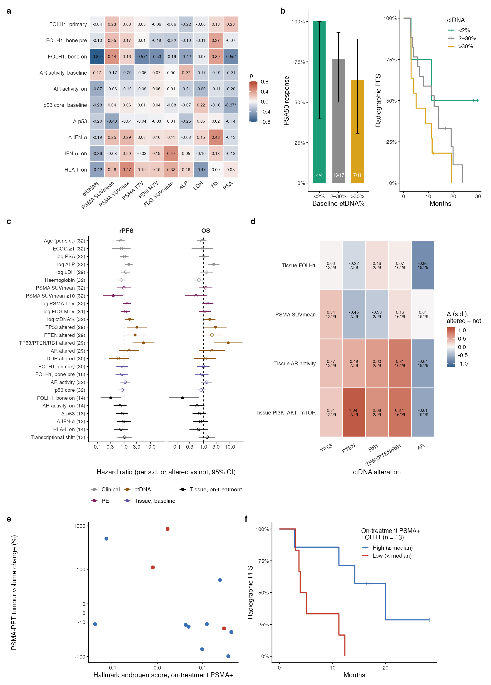

**Fig. 3 | Tissue phenotype in the context of tumour burden, genotype and prognosis.** **a**, Spearman correlation of patient-level tissue programmes with baseline tumour-burden measures: ctDNA fraction, PSMA-PET parameters (SUVmean, SUVmax, total tumour volume (TTV)), FDG-PET parameters (SUVmean, metabolic tumour volume (MTV)) and laboratory markers (ALP, alkaline phosphatase; LDH, lactate dehydrogenase; Hb, haemoglobin; PSA, baseline prostate-specific antigen) (* P < 0.05, ** P < 0.01; † Bonferroni-corrected P < 0.05 across burden variables, reached only by on-treatment *FOLH1* versus ctDNA fraction, ρ = −0.89, n = 14). **b**, PSA50 response rate (exact 95% confidence interval; numbers, PSA50 responders/patients) and Kaplan–Meier estimates of rPFS by baseline ctDNA fraction in the TheraP categories (<2%, 2–30%, >30%), in all 32 patients (24 PSA50 responders and 8 PSA50 failures; the same 32 patients as in Fig. 2e). The hazard ratio (HR) per higher category from Cox regression was 2.1 (P = 0.028). **c**, Univariable Cox hazard ratios (95% confidence interval) for rPFS and overall survival (OS): continuous variables per s.d., binary variables altered versus not altered; filled symbols, P < 0.05; number of patients in parentheses; colour, variable class (grey, clinical; plum, PET; brown, ctDNA; indigo, baseline tissue; black, on-treatment tissue). ECOG, Eastern Cooperative Oncology Group performance status; ALP, alkaline phosphatase; LDH, lactate dehydrogenase; TTV, total tumour volume; MTV, metabolic tumour volume; DDR, DNA-damage repair (*ATM*, *BRCA2*, *CDK12* or *CHEK2*). On-treatment tissue features were measured 2–4 weeks after the first dose; *RB1* (two altered patients) is omitted. **d**, Difference in tissue *FOLH1*, AR activity (Hallmark androgen response) and PI3K–AKT–mTOR activity, and in PSMA-PET SUVmean, between patients with and without each ctDNA alteration, adjusted for log ctDNA fraction (colour, standardized difference; * P < 0.05; numbers, altered/evaluable patients). **e**, On-treatment Hallmark androgen-response score in PSMA⁺ AOIs (patient pseudobulk) versus percentage change in PSMA-PET total tumour volume from baseline to cycle 5 (pseudo-log scale), coloured by response group (blue, responder; amber, intermediate; red, non-responder) (ρ = −0.66, P = 0.020; n = 12). **f**, Kaplan–Meier estimates of rPFS by median split of on-treatment *FOLH1* in PSMA⁺ AOIs (PSMA⁺ stratum, n = 13; log-rank P = 0.014); Cox regression of the continuous value gave HR 0.37 per s.d. (P = 0.021).

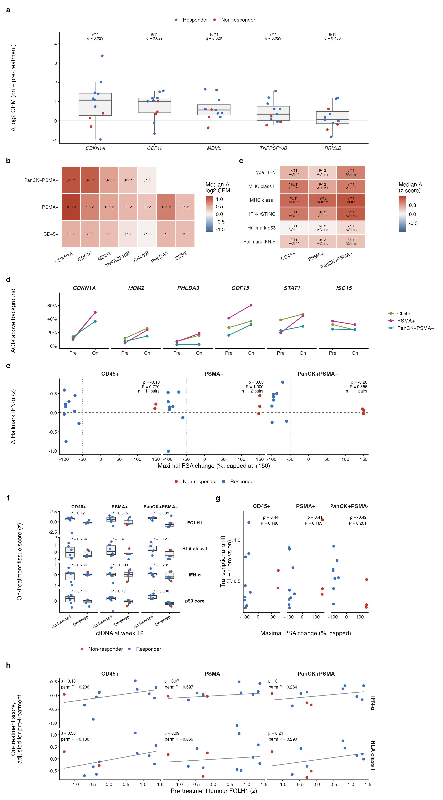

**Fig. 4 | On-treatment p53 and interferon/antigen-presentation programmes in paired bone biopsies after radioligand therapy.** All panels compare matched pre-treatment and on-treatment (2–4 weeks after the first dose) bone biopsies; no intermediate patient had on-treatment tissue, so points are responders (blue) and non-responders (red). **a**, Paired change (on-treatment minus pre-treatment, log₂ CPM) in canonical p53 target genes in PanCK⁺PSMA⁻ patient pseudobulk (11 patients); each point is one patient (boxes, interquartile range; centre line, median; whiskers, most extreme values within 1.5 × the interquartile range); numbers show patients with an increase out of all pairs and the Wilcoxon signed-rank false discovery rate (q). **b**, Median paired change in the same canonical p53 targets and the number of patients with an increase, in each compartment (* FDR < 0.05). **c**, Median paired change in pre-specified interferon and antigen-presentation programmes per compartment (numbers, patients increasing/pairs, preceded by the pseudobulk Wilcoxon signed-rank result: * P < 0.05, ** P < 0.01, *** P < 0.001), with confirmation by AOI-level mixed models (feature ~ timepoint + (1 | patient); AOI *, P < 0.05; AOI **, P < 0.01; AOI ***, P < 0.001; ns, not significant). **d**, Percentage of AOIs with expression above the negative-probe limit of quantification (LOQ) before and on treatment, a readout that does not depend on normalization. **e**, Paired change in Hallmark interferon-α score versus maximal PSA change in each compartment, coloured by response group; Spearman ρ, P and number of paired patients shown (11, 12 and 11). PSA increases above +150% are displayed at +150% (display only); analyses used maximal PSA change capped at +100%. **f**, On-treatment tissue *FOLH1*, HLA class I, Hallmark interferon-α and p53-core scores (patient pseudobulk, z-scores within stratum) in patients with detectable (≥1%) versus undetectable ctDNA at week 12 (Wilcoxon rank-sum P; detectable/undetectable, 5/6 patients in CD45⁺ and PSMA⁺ and 6/5 in PanCK⁺PSMA⁻ AOIs); boxes, interquartile range; centre line, median; whiskers, most extreme values within 1.5 × the interquartile range. **g**, Magnitude of transcriptional change between each patient's paired biopsies (1 − Pearson r over the 2,000 most variable genes) versus maximal PSA change; the median within-patient shift (0.41) was smaller than the median distance between different patients (1.07). PSA increases above +150% are displayed at +150% (display only); analyses used maximal PSA change capped at +100%. **h**, Pre-treatment tumour *FOLH1* (mean within-stratum z-score of pre-treatment PSMA⁺ and PanCK⁺PSMA⁻ pseudobulk) versus on-treatment Hallmark interferon-α and HLA class I scores adjusted for each patient's pre-treatment score (residuals of on-treatment on pre-treatment score), per compartment (CD45⁺ n = 11, PSMA⁺ n = 12, PanCK⁺PSMA⁻ n = 11); colour, response group (no intermediate patient had paired tissue); line, least-squares fit; β, ANCOVA coefficient (s.d. of score per s.d. of *FOLH1*) with P from 5,000 permutations of *FOLH1* across patients.

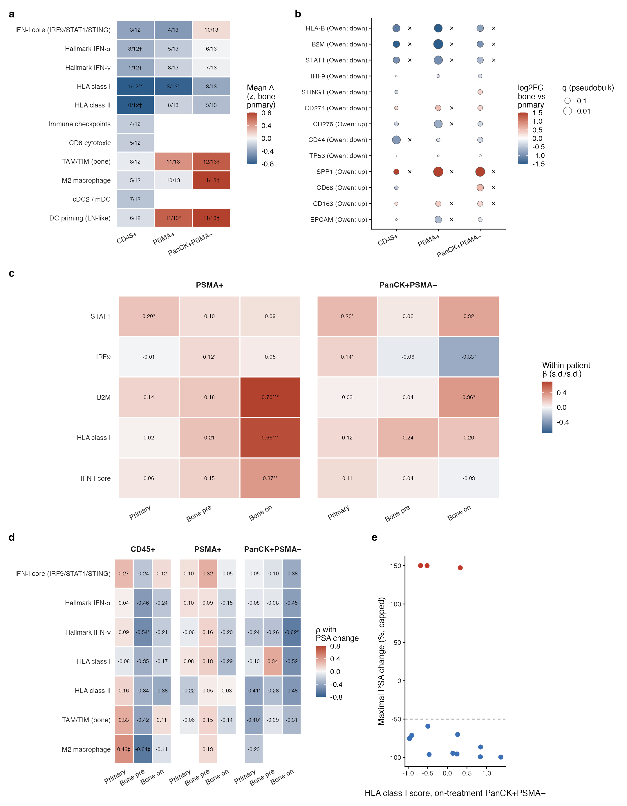

**Fig. 5 | Primary-to-bone immune remodelling and the on-treatment interferon response: comparison with Owen et al.** **a**, Change in immune programmes from the archival primary tumour to the pre-treatment bone metastasis in matched patients, per compartment (colour, mean paired change in z-score; numbers, patients higher in bone out of all pairs; * Wilcoxon signed-rank P < 0.05; † FDR < 0.1 and robust to an expression-matched null). Blank cells, programmes with fewer than three genes detected above LOQ. TAM/TIM, tumour-associated macrophages and tumour-inflammatory monocytes of the bone-metastasis atlas (Kfoury et al.); cDC2/mDC, conventional type 2 and mature dendritic cells; LN-like, lymph-node-like DC priming programme. **b**, Marker genes reported by Owen et al. to differ between bone and primary prostate cancer: log₂ fold change bone versus primary in our paired pseudobulk (colour) and paired FDR (point size); ×, also FDR < 0.05 in AOI-level models with patient blocking. The direction reported by Owen et al. is shown in parentheses after each gene. **c**, Within-patient association between *CD276* (B7-H3) and interferon and HLA class I programmes across AOIs of the tumour compartments in primary tumour and bone (standardized β from target ~ *CD276* + (1 | patient); * P < 0.05, ** P < 0.01, *** P < 0.001). Owen et al. predict negative associations in bone. **d**, Spearman correlation of interferon, antigen-presentation and myeloid programmes with maximal PSA change in each compartment × timepoint stratum (negative ρ, higher with greater PSA decline; * nominal P < 0.05, uncorrected for multiple testing; ‡ P < 0.05 in every leave-one-patient-out (LOO) refit). Patients per stratum (primary/pre-treatment bone/on-treatment bone): CD45⁺ 28/15/13, PSMA⁺ 29/16/13, PanCK⁺PSMA⁻ 30/15/13. No on-treatment CD45⁺ association reached P < 0.05, with or without adjustment for tissue composition (Extended Data Fig. 4e). **e**, On-treatment HLA class I score in PanCK⁺PSMA⁻ AOIs (patient pseudobulk) versus maximal PSA change, coloured by response group (blue, responder; amber, intermediate; red, non-responder; no intermediate patient had on-treatment tissue) (ρ = −0.52, P = 0.071; n = 13). PSA increases above +150% are displayed at +150% (display only); analyses used maximal PSA change capped at +100%.

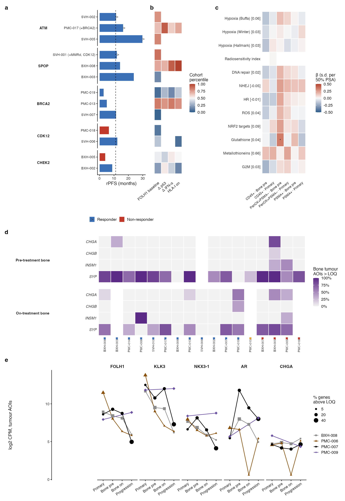

**Fig. 6 | DNA repair, lineage plasticity, radiobiology and acquired resistance.** **a**, rPFS of each of the 13 patients with a ctDNA alteration in *ATM*, *SPOP*, a mismatch-repair (MMR) gene, *BRCA2*, *CDK12* or *CHEK2*, grouped by the first altered gene in that order (3 *ATM*, 3 *SPOP*, 3 *BRCA2*, 2 *CDK12*, 2 *CHEK2*) and ordered by rPFS; co-occurring alterations are given in parentheses (the single MMR-altered patient, SVH-001, also carried *SPOP* and *CDK12* alterations and is shown in the *SPOP* group); bars coloured by response group (blue, responder; red, non-responder); >, censored; dashed line, cohort median rPFS (11.2 months). **b**, For the same patients, the cohort percentile of baseline *FOLH1*, of the paired on-treatment change in p53 and interferon-α programmes and of on-treatment HLA class I (blank, no tissue). **c**, Association of the pre-specified radiobiology panel with PSA change in the primary and pre-treatment bone strata: hypoxia (Buffa, Winter and Hallmark signatures), the radiosensitivity index (RSI), Hallmark DNA repair, non-homologous end joining (NHEJ, KEGG), homologous recombination (HR, KEGG), Hallmark reactive oxygen species (ROS), NRF2 target genes, glutathione metabolism (KEGG), metallothioneins and Hallmark G2/M checkpoint (colour, β per 50-percentage-point worse PSA change; positive, higher with worse response; brackets, median gene–gene correlation within the programme; * P < 0.05; no association reached FDR < 0.1). The RSI could be scored only where all ten RSI genes passed the detection filter (primary CD45⁺ AOIs); its other cells are blank. **d**, Fraction of each patient's bone tumour AOIs (PSMA⁺ and PanCK⁺PSMA⁻ pooled) with the neuroendocrine markers *CHGA*, *CHGB*, *INSM1* or *SYP* above the negative-probe LOQ, in pre-treatment bone (16 patients: 4 non-responders, 12 others) and on-treatment bone (14 patients: 3 non-responders, 11 others); blank, no tissue at that timepoint; patients (17 with any bone tissue) ordered by PSA response (squares below, response group: blue, responder; amber, intermediate; red, non-responder). In pre-treatment bone, *CHGA* was above LOQ in at least half of the tumour AOIs in 1 of 4 non-responders versus 0 of 12 other patients (Fisher P = 0.25), and *INSM1* was detected in 2 of 4 versus 0 of 12 (Fisher's exact P = 0.050 for patients with any detection; Wilcoxon rank-sum P = 0.015 for the per-patient detected fraction). *SYP* is also detected in control tissue. **e**, Tumour AOIs of the four initial responders with progression biopsies: mean log₂ CPM of *FOLH1*, AR-output genes (*KLK3*, *NKX3-1*), *AR* and *CHGA* at each available timepoint (colour and symbol, patient); point size, percentage of genes above LOQ in the AOI (signal depth). PMC-007 is the case with high-quality progression tissue.
## Extended Data figures

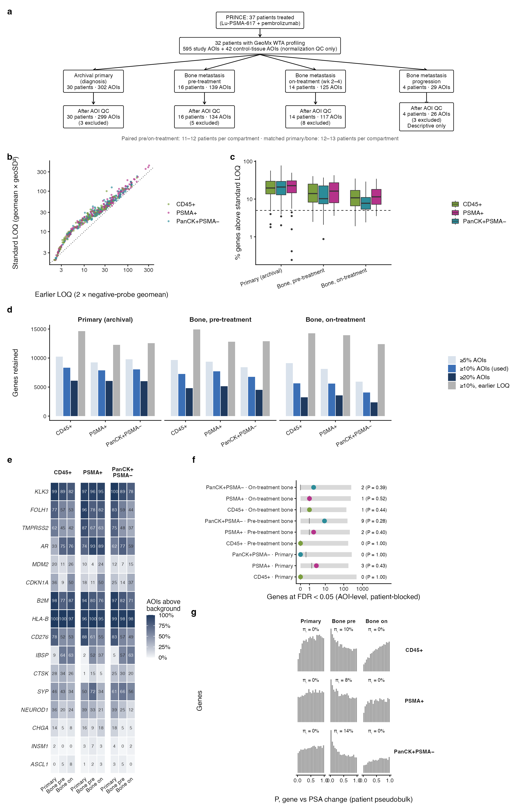

**Extended Data Fig. 1 | Sample flow, negative-probe background and the scale of response-associated signal.** **a**, Patients and areas of illumination (AOIs) per timepoint before and after AOI quality control (WTA, GeoMx Whole Transcriptome Atlas). Control-tissue AOIs were used only for normalization quality control and progression biopsies only descriptively. **b**, Per-AOI limit of quantification (LOQ): the standard threshold (geometric mean × geometric s.d.² of the 139 negative probes) versus the threshold used in an earlier analysis (2 × geometric mean); colour, compartment (green, CD45⁺; magenta, PSMA⁺; teal, PanCK⁺PSMA⁻). **c**, Percentage of genes above the standard LOQ per AOI by timepoint and compartment (boxes, interquartile range; centre line, median; whiskers, most extreme values within 1.5 × the interquartile range; points beyond the whiskers shown individually); the 50 of 550 analysed AOIs below 5% (dashed line) were excluded in sensitivity analyses. **d**, Number of genes retained per compartment × timepoint stratum (gene universe) under increasing detection thresholds (percentage of AOIs in which the gene is above LOQ; the ≥10% threshold was used) and, for comparison, at ≥10% with the earlier LOQ. **e**, Percentage of AOIs with expression above the per-AOI LOQ for selected genes in primary tumour, pre-treatment bone and on-treatment bone (bone pre, bone on); the neuroendocrine transcription factors *ASCL1* and *INSM1* are at background. **f**, AOI-level limma-voom with patient blocking: number of genes associated with PSA change at FDR < 0.05 (dot) compared with the distribution obtained when PSA change was permuted across patients (200 permutations; tick, null median; bar, up to the null 95th percentile); permutation P in parentheses. **g**, Distribution of gene-level P values for association with PSA change in patient-level pseudobulk (batch-adjusted) per stratum, with the estimated fraction of associated genes (π₁); no stratum had more than two genes at FDR < 0.1, and none had any at FDR < 0.05.

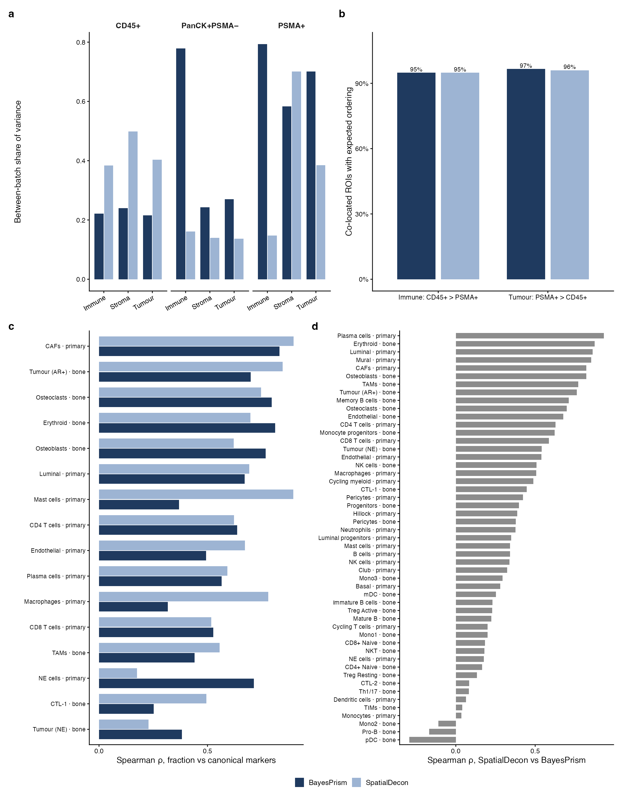

**Extended Data Fig. 2 | Comparison of deconvolution methods: SpatialDecon versus BayesPrism.** Cell-type fractions were estimated for every AOI with both methods using the same tissue-matched single-cell references (light blue, SpatialDecon; dark blue, BayesPrism). **a**, Share of variance in lineage fractions explained by sequencing batch in technical-replicate control tissue (lower values indicate greater robustness to batch). **b**, Percentage of co-located ROIs in which the expected compartment ordering holds (immune fraction higher in CD45⁺ than PSMA⁺ AOIs; tumour fraction higher in PSMA⁺ than CD45⁺ AOIs). **c**, Spearman correlation of each estimated cell-type fraction with canonical marker genes for that cell type, per reference (primary, PCCAT primary-tumour reference; bone, bone-metastasis reference). **d**, Spearman correlation between SpatialDecon and BayesPrism estimates for each cell type. Cell types: Tumour (AR+) and Tumour (NE), AR-active and neuroendocrine tumour cells; TAMs/TIMs, tumour-associated macrophages/tumour-inflammatory monocytes; CTL, cytotoxic T lymphocytes; NE cells, neuroendocrine epithelial cells; CAFs, cancer-associated fibroblasts; mDC/pDC, mature/plasmacytoid dendritic cells; other labels as in the source atlases.

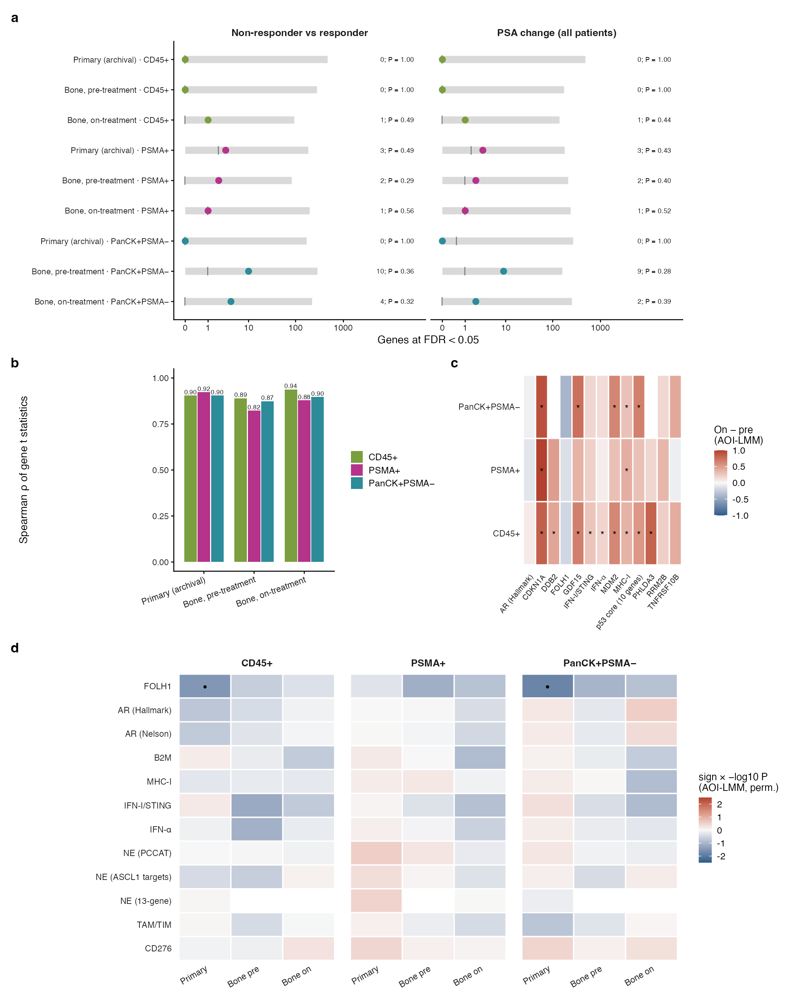

**Extended Data Fig. 3 | AOI-level analysis arm and its calibration.** **a**, AOI-level limma-voom with patient blocking (two-pass duplicateCorrelation) for continuous PSA change and for non-responders versus responders: number of genes at FDR < 0.05 (dot) against the distribution under 200 patient-level label permutations (tick, null median; bar, to the null 95th percentile), with permutation P. **b**, Spearman correlation of gene-wise moderated t statistics between the AOI-level and patient pseudobulk analyses per stratum, showing that gene rankings agree. **c**, On-treatment change in pre-specified features estimated by AOI-level mixed models (feature ~ timepoint + (1 | patient)); * FDR < 0.05. **d**, AOI-level linear mixed models for pre-specified features (feature ~ PSA change + batch + (1 | patient)); colour, signed −log₁₀ patient-permutation P (blue, higher with greater PSA decline); ●, permutation P < 0.05 at AOI level and P < 0.05 in patient pseudobulk (both displayed AOI-level hits, *FOLH1* in primary CD45⁺ and primary PanCK⁺PSMA⁻ AOIs, were also significant in pseudobulk, so no displayed feature was significant at AOI level alone). NE, neuroendocrine; NEPC, neuroendocrine prostate cancer; TAM/TIM, tumour-associated macrophage/tumour-inflammatory monocyte programme.

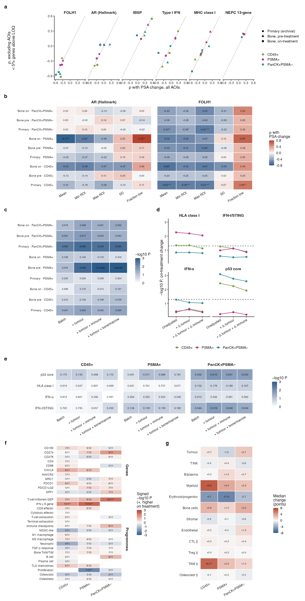

**Extended Data Fig. 4 | Robustness to low-signal AOIs, spatial heterogeneity and tissue composition, and on-treatment change of the immune microenvironment.** **a**, Spearman correlation of key features with maximal PSA change using all AOIs versus after excluding the 50 AOIs with fewer than 5% of genes above LOQ; dotted line, identity; NEPC 13-gene, neuroendocrine prostate cancer signature. **b**, Summaries of ROI-level *FOLH1* and Hallmark androgen-response scores (mean, minimum, maximum, standard deviation and fraction of ROIs in the cohort's lowest quartile) versus PSA change, in patients with at least two ROIs (Spearman ρ; * P < 0.05, ** P < 0.01, *** P < 0.001). Low *FOLH1* was lesion-wide rather than confined to a few regions. **c**, Association of *FOLH1* with PSA change (P for the PSA term) with batch alone and after adding count-weighted SpatialDecon tumour, immune and bone/marrow fractions as covariates; lower *FOLH1* was associated with worse response in all strata. **d**, Significance of the on-treatment change in p53, HLA class I and interferon programmes in paired pseudobulk, unadjusted and after regressing each patient's change on their change in tumour (and immune) fraction; dashed line, P = 0.05. **e**, Association of on-treatment p53-core, HLA class I, Hallmark interferon-α and IFN-I/STING scores with PSA change (P for the PSA term; patient pseudobulk, n = 13 per compartment) with batch alone and after adding the same composition covariates as in **c**. In CD45⁺ AOIs neither HLA class I (P = 0.62 with batch alone; 0.67 after adjustment for tumour and bone/marrow fractions) nor p53 core (0.18; 0.17) was associated with PSA change; in PanCK⁺PSMA⁻ AOIs, p53 core P was 0.013 after adjustment for tumour fraction (0.032 with batch alone). **f**, On-treatment change of immune-microenvironment programmes and genes in paired patient pseudobulk (pre-treatment to on-treatment bone; CD45⁺ n = 11, PSMA⁺ n = 12, PanCK⁺PSMA⁻ n = 11): fill, signed −log₁₀ Wilcoxon signed-rank P (red, higher on treatment); text, patients with an increase / pairs; ** FDR < 0.05, * FDR < 0.1 (BH within compartment and family); blank cells, fewer than three programme genes, or the gene, above the limit of quantification. GEP, gene expression profile; IFN-γ 6-gene, Ayers et al. interferon-γ signature; MDSC, myeloid-derived suppressor cell; TAM/TIM, tumour-associated macrophages and inflammatory monocytes; TCF7 stem-like, TCF7⁺ stem-like T cells; TGF-β, transforming growth factor-β; TLS, tertiary lymphoid structure; Treg, regulatory T cell. **g**, Median change (percentage points) of library-size-weighted SpatialDecon fractions per patient; ** FDR < 0.05, † FDR < 0.1 (Wilcoxon signed-rank test on logit fractions, BH within compartment and level); ‡, individual immune cell types, which are less reliably deconvolved than major lineages (exploratory). CTL, cytotoxic T lymphocyte.

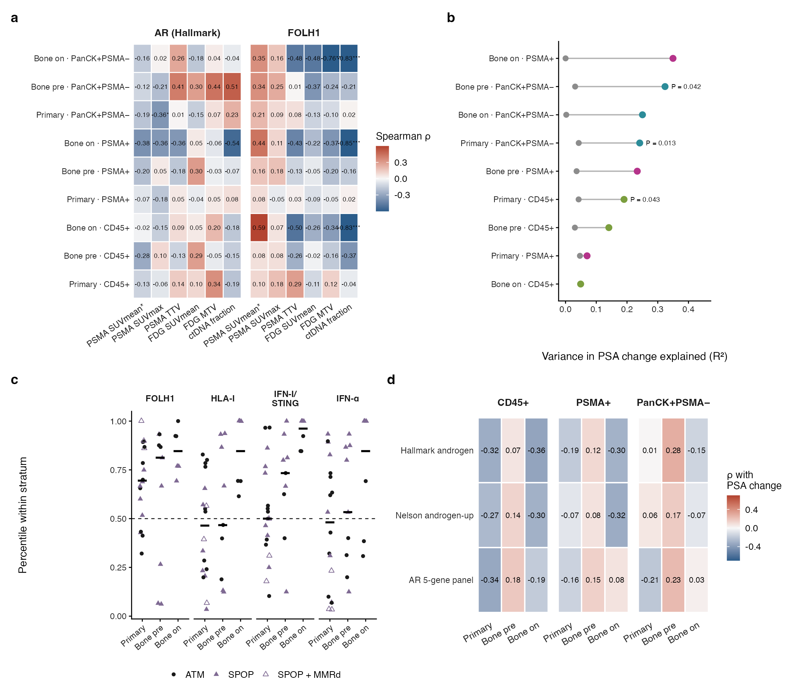

**Extended Data Fig. 5 | Tissue transcriptome, PET imaging and liquid biopsy.** This figure links the tissue data with the companion PRINCE ctDNA, circulating tumour cell and PET analysis. **a**, Spearman correlation of patient-level tissue *FOLH1* and Hallmark androgen-response score with baseline PSMA-PET (SUVmean, SUVmax, total tumour volume (TTV)), FDG-PET (SUVmean, metabolic tumour volume (MTV)) and baseline ctDNA fraction; on-treatment tissue is compared with PSMA-PET SUVmean at cycle 5 (* P < 0.05). **b**, Variance in maximal PSA change explained (R²) by PSMA-PET SUVmean alone (grey) and after adding tissue *FOLH1* (colour, compartment) per stratum; P, F-test for the added *FOLH1* term (shown where P < 0.05). **c**, Within-stratum percentile of tissue programmes in the six patients with *ATM* (black circles; n = 3), *SPOP* (purple filled triangles; n = 2) or concurrent *SPOP* and mismatch-repair (MMRd; open triangles; n = 1, SVH-001) alterations in ctDNA, all of whom responded (compartments pooled; bar, median). **d**, Spearman correlation of externally defined AR-activity signatures (Hallmark androgen response, Nelson androgen-induced genes and a five-gene AR panel) with maximal PSA change per stratum (* P < 0.05). Signatures were scored per patient pseudobulk with singscore (rank-based; R3 external-signature analysis); scoring as mean z-score gives slightly stronger primary CD45⁺ correlations (Hallmark ρ = −0.37, Nelson ρ = −0.31, panel ρ = −0.38).

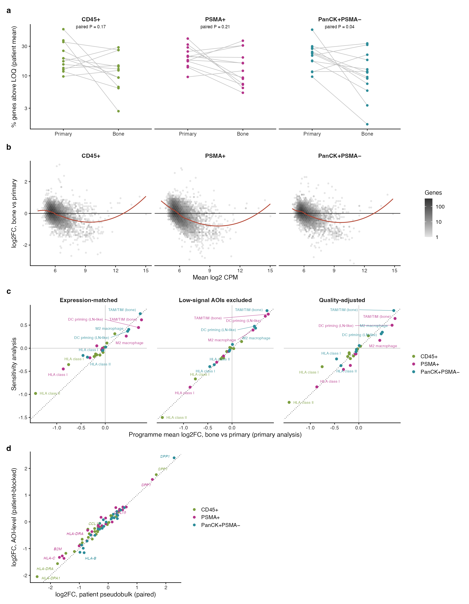

**Extended Data Fig. 6 | Primary-to-bone comparison: controls for tissue type, decalcification and RNA quality.** **a**, Percentage of genes above LOQ (patient mean) in matched primary and bone tissue per compartment; mean signal depth was lower in bone than in matched primary tissue (14–16% versus 21–23% of genes above LOQ), significantly so only in PanCK⁺PSMA⁻ AOIs (paired Wilcoxon P = 0.17, 0.21 and 0.036 for CD45⁺, PSMA⁺ and PanCK⁺PSMA⁻ AOIs). **b**, Gene-wise log₂ fold change (bone versus primary) against mean expression; red line, loess fit. Highly expressed genes trend lower in bone, most in PSMA⁺ AOIs (loess minimum about −0.8 log₂ fold change), so an intensity-dependent component cannot be excluded; the programme-level conclusions were therefore checked against the expression-matched and quality-adjusted analyses in **c**. **c**, Primary-to-bone programme changes in the primary analysis versus three sensitivity analyses: expression-matched relative change, adjustment for AOI quality and exclusion of low-signal AOIs. **d**, Owen et al. marker genes: log₂ fold change (bone versus primary) in paired pseudobulk versus AOI-level analysis with patient blocking (Pearson r = 0.98).

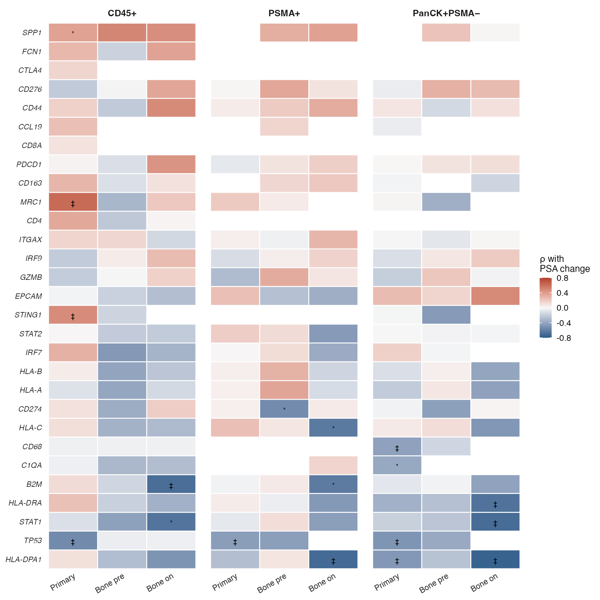

**Extended Data Fig. 7 | Owen et al. bone-metastasis marker genes versus PSA response.** Spearman correlation of patient-level pseudobulk expression with maximal PSA change for each marker gene detected above LOQ, per compartment × timepoint stratum (* P < 0.05; ‡ P < 0.05 in every leave-one-patient-out refit). Blank cells, gene below LOQ in that stratum.

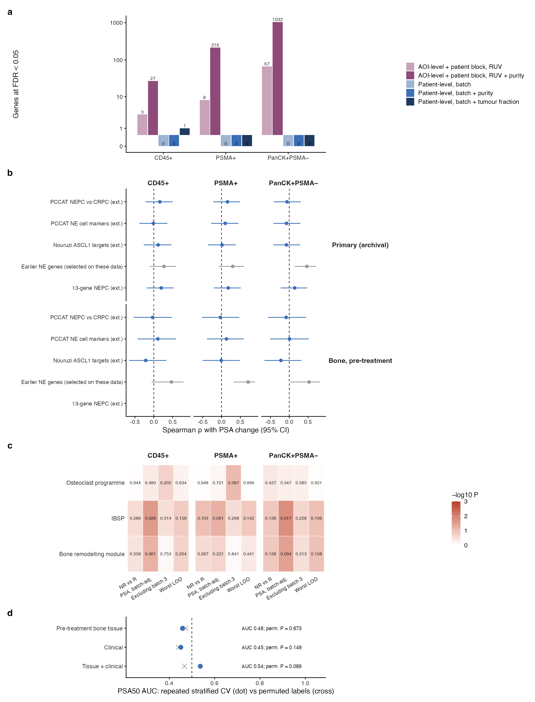

**Extended Data Fig. 8 | Re-evaluation of findings from an earlier analysis of these samples.** NR, non-responder; R, responder. **a**, Number of genes at FDR < 0.05 for non-responders versus responders in pre-treatment bone metastases, in the earlier AOI-level models (patient-blocked limma with RUV normalization, with or without ESTIMATE purity as a covariate) and in patient-level pseudobulk under three covariate sets. **b**, Spearman correlation with PSA change of externally defined neuroendocrine (NE) and neuroendocrine prostate cancer (NEPC) signatures (blue) and of gene sets previously selected on response in these data (grey; circular because selection and testing used the same samples). **c**, P values for bone-niche genes and programmes identified post hoc in the earlier analysis (pre-treatment bone), under four approaches: NR versus R (Wilcoxon), PSA change adjusted for batch, PSA change excluding sequencing batch 3 (which contains all intermediate patients), and the largest P over leave-one-patient-out (LOO) refits. **d**, Performance of elastic-net models built from pre-treatment bone tissue features, clinical features or both for predicting PSA50 under repeated stratified cross-validation (dot, observed area under the curve) compared with permuted labels (cross); no feature set predicted PSA50.

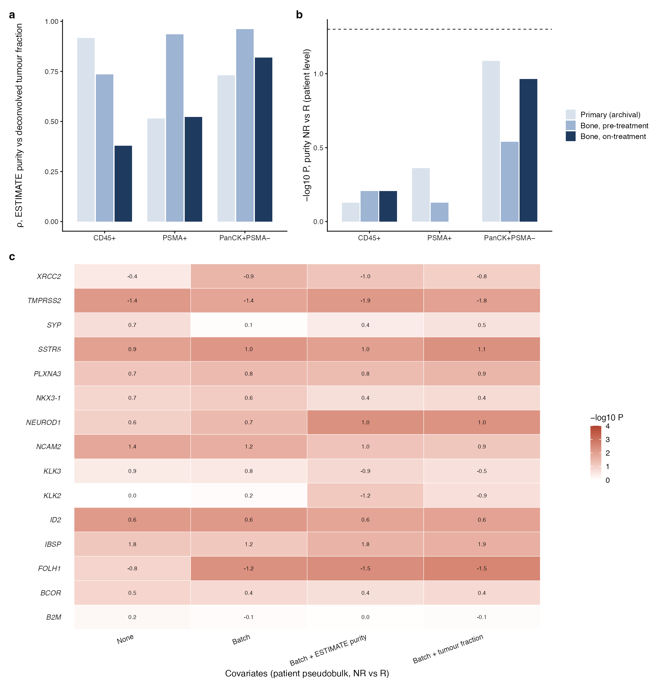

**Extended Data Fig. 9 | Tumour purity estimates and their effect on differential expression.** NR, non-responder; R, responder. **a**, Spearman correlation between ESTIMATE purity, an expression-derived proxy for tumour content, and SpatialDecon tumour fraction across patients (patient pseudobulk) per stratum (ρ = 0.51–0.96 in the tumour compartments and 0.38–0.92 in CD45⁺ AOIs). **b**, −log₁₀ P of the patient-level comparison of ESTIMATE purity between non-responders and responders (Wilcoxon rank-sum) per compartment, coloured by timepoint; dashed line, P = 0.05. Purity did not differ by response in any stratum (all P ≥ 0.08). **c**, Genes named in the earlier analysis, in pre-treatment PanCK⁺PSMA⁻ bone metastasis AOIs, tested in patient pseudobulk with no covariates, batch, batch plus ESTIMATE purity, or batch plus SpatialDecon tumour fraction (colour, −log₁₀ P; label, log₂ fold change non-responder versus responder). No gene reaches FDR < 0.05.

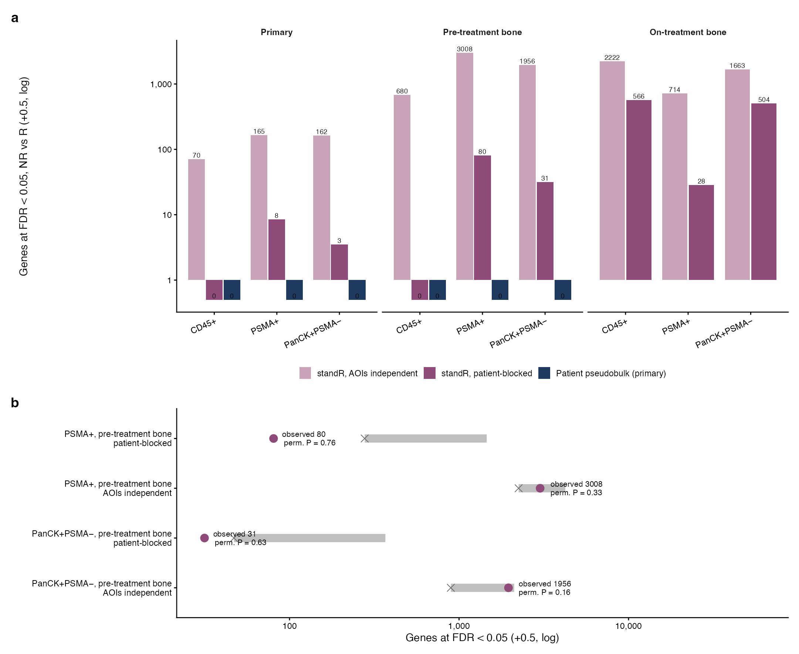

**Extended Data Fig. 10 | The standR workflow and its calibration.** NR, non-responder; R, responder. **a**, Number of genes at FDR < 0.05 for non-responders versus responders per stratum using the standR (Bioconductor) workflow with AOIs treated as independent or with patient blocking, compared with patient-level pseudobulk (pseudobulk counts are not shown for on-treatment strata); counts are plotted +0.5 on a log scale. **b**, Pre-treatment bone strata: observed standR gene counts (dot) versus the same workflow applied to 50 sets of patient-shuffled response labels (cross, null median; bar, to the null 90th percentile); perm. P, permutation P.

## Supplementary figures

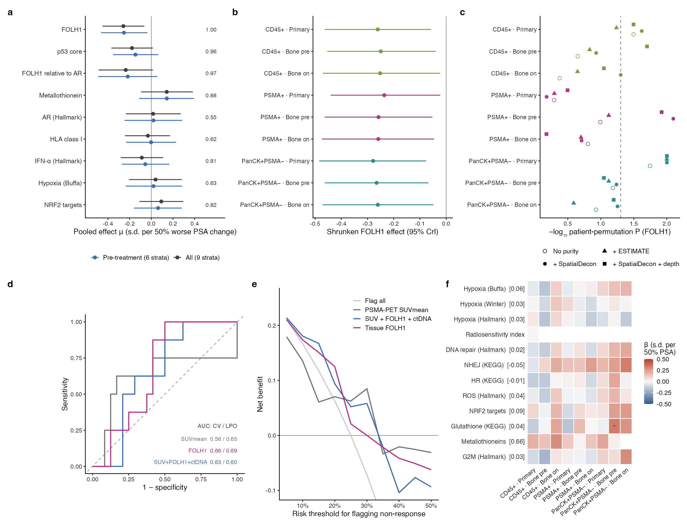

**Supplementary Fig. 1 | Robustness and patient-selection analyses for tissue *FOLH1*.** Panels **d** and **e** are also summarized in Fig. 2e. **a**, Bayesian hierarchical model pooling the association of tissue *FOLH1* (and other pre-specified features) with PSA change across the six pre-treatment strata (blue) or all nine strata (black), with a patient random effect and partial pooling of the stratum-specific effects: posterior mean and 95% credible interval (CrI); numbers, posterior probability of the observed direction over all nine strata (0.995 for *FOLH1* and 0.96 for p53 core; 0.55–0.97 for the other features). **b**, Shrunken stratum-specific *FOLH1* effects from the same model (between-stratum s.d. τ = 0.05). **c**, AOI-level mixed models separating each patient's mean purity from the AOI's deviation from it (*FOLH1* ~ PSA change + batch + purity between + purity within + (1 | patient)): *FOLH1* patient-permutation P per stratum (x axis, −log₁₀ P; dashed line, P = 0.05) without purity terms (open circles), with SpatialDecon tumour fraction (filled circles), with ESTIMATE purity (triangles), or with SpatialDecon tumour fraction plus AOI signal depth (squares); colour, compartment. **d**, Receiver operating characteristic curves for predicting PSA50 failure (8 of 32 evaluable patients) from out-of-fold predicted probabilities (50 × stratified four-fold cross-validation; CV, mean cross-validated area under the curve; LPO, leave-pair-out). **e**, Decision curve: net benefit across threshold probabilities of flagging likely non-responders with each model, compared with flagging all or no patients, using out-of-fold probabilities. **f**, Pre-specified radiobiology panel: β for PSA change per stratum (positive, higher with worse response; brackets, median gene–gene correlation across pre-treatment strata; * P < 0.05; none FDR < 0.1).

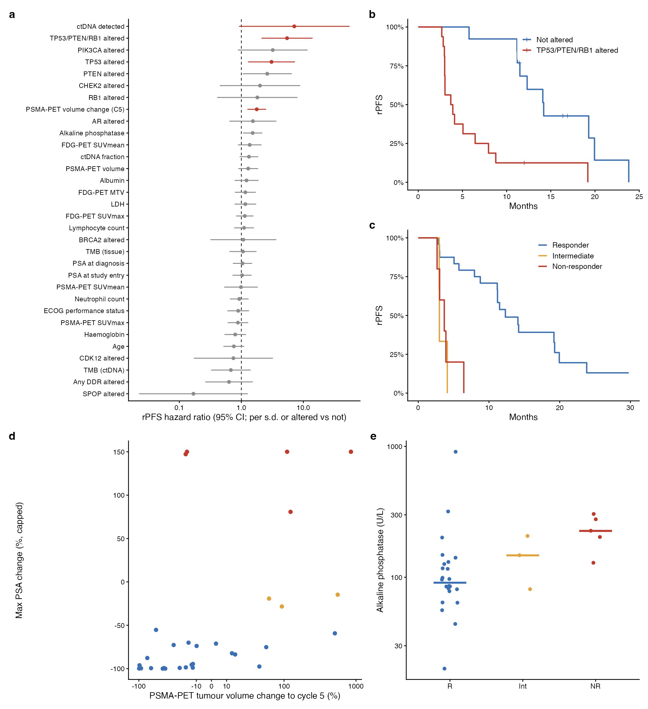

**Supplementary Fig. 2 | Clinical, imaging and ctDNA predictors of outcome.** **a**, Univariable Cox hazard ratios (95% confidence interval) for radiographic progression-free survival (rPFS), per s.d. for continuous variables or altered versus not altered for ctDNA alterations; red, FDR < 0.1. Variables are baseline clinical, laboratory, PSMA- and FDG-PET and ctDNA measures (ECOG, Eastern Cooperative Oncology Group; LDH, lactate dehydrogenase; MTV, metabolic tumour volume; TMB, tumour mutational burden; C5, cycle 5; DDR, DNA-damage repair). Where the trial database held the same PET measure twice, one copy is shown; variables with non-estimable hazard ratios (*ATM* and MMR alteration, FDG-PET positivity) are omitted. **b**, Kaplan–Meier estimates of rPFS by ctDNA alteration in *TP53*, *PTEN* or *RB1* (red, any altered; blue, none; log-rank P = 1.4 × 10⁻⁴). **c**, rPFS by PSA response group (blue, responder; amber, intermediate; red, non-responder). **d**, Percentage change in PSMA-PET total tumour volume from baseline to cycle 5 (pseudo-log scale) versus maximal PSA change, coloured by response group; imaging and PSA response agree. PSA increases above +150% are displayed at +150% (display only); analyses used maximal PSA change capped at +100%. **e**, Baseline serum alkaline phosphatase, a bone-turnover marker, by response group (R, responder; Int, intermediate; NR, non-responder; bar, median; log scale).

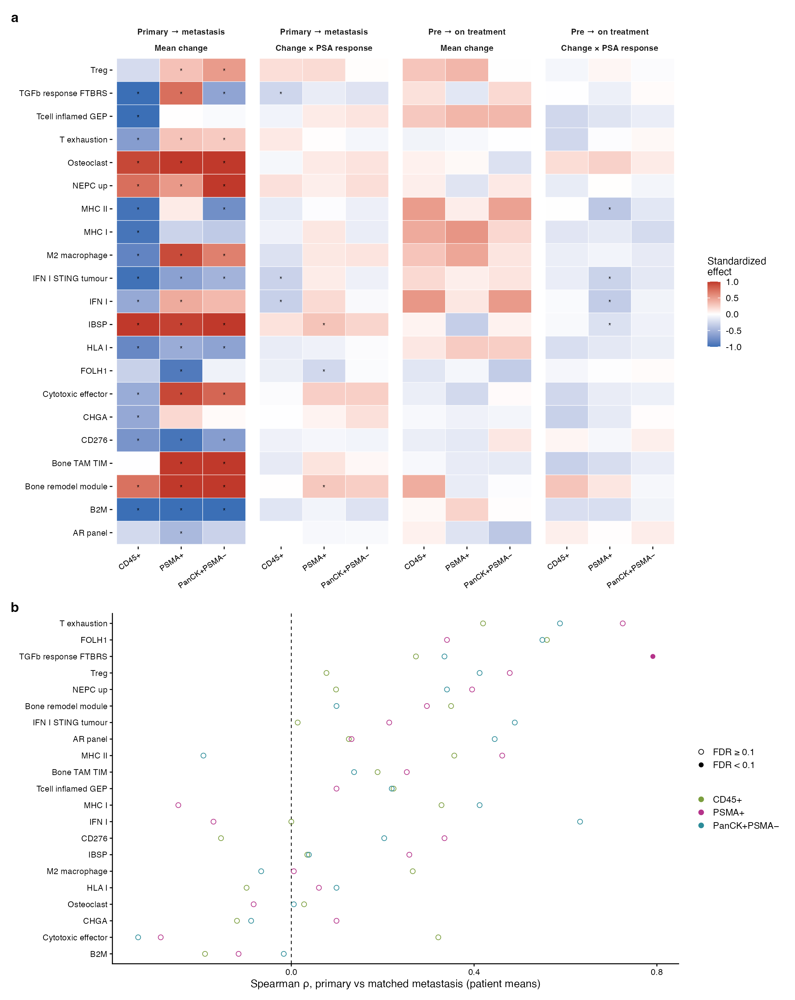

**Supplementary Fig. 3 | AOI-level longitudinal programme change and primary–metastasis concordance.** **a**, Programme change in matched patients from AOI-level mixed models, per compartment: mean change from archival primary tumour to pre-treatment bone metastasis and from pre-treatment to on-treatment bone (colour, standardized effect), and the interaction of each change with PSA response (positive, larger rise with worse response); * FDR < 0.1. **b**, Spearman correlation between each patient's mean programme score in the archival primary tumour and in the matched pre-treatment bone metastasis, per compartment (green, CD45⁺; magenta, PSMA⁺; teal, PanCK⁺PSMA⁻); filled symbols, FDR < 0.1; open symbols, FDR ≥ 0.1. In the bone-only matched set (12–13 patients per compartment) only one correlation reached FDR < 0.1 (TGF-β response in PSMA⁺ AOIs, ρ = 0.79); *FOLH1* correlations were 0.34–0.56 (FDR ≥ 0.6).

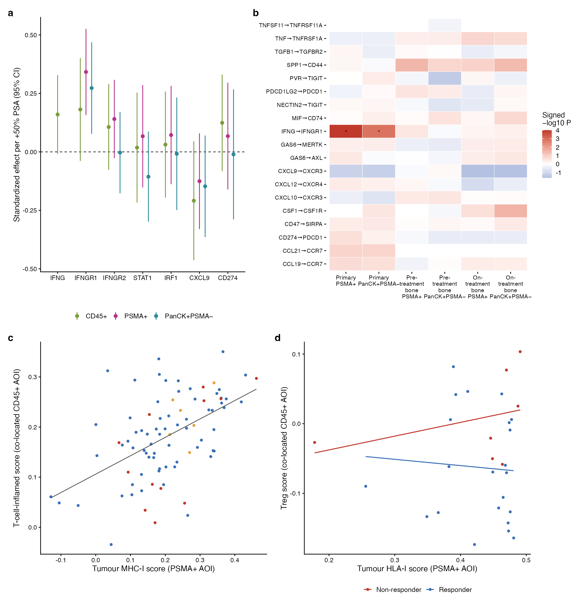

**Supplementary Fig. 4 | Exploratory within-ROI crosstalk between tumour and immune compartments.** These AOI-level analyses were not calibrated by patient-level permutation and are hypothesis-generating. **a**, Primary tumours: association of interferon-γ pathway genes with PSA change per compartment (standardized effect per +50 percentage points of PSA change, 95% confidence interval; positive, higher with worse response). *IFNGR1* is higher with worse response without a corresponding change in downstream interferon-γ response genes. **b**, Ligand–receptor co-expression across co-located AOIs (ligand in one compartment, receptor in another) versus PSA change per stratum (primary, pre-treatment bone and on-treatment bone; tumour compartment named below) (signed −log₁₀ P; red, higher with worse response; * FDR < 0.1). **c**, Primary tumours: tumour MHC class I score in PSMA⁺ AOIs versus T-cell-inflamed score in the co-located CD45⁺ AOI of the same ROI, coloured by response group (blue, responder; amber, intermediate; red, non-responder); line, least-squares fit. **d**, Pre-treatment bone metastases: tumour HLA class I score in PSMA⁺ AOIs versus regulatory T-cell (Treg) score in the co-located CD45⁺ AOI, with separate fits for responders (blue) and non-responders (red); in bone-only data the coupling did not differ by response (interaction FDR = 0.85).

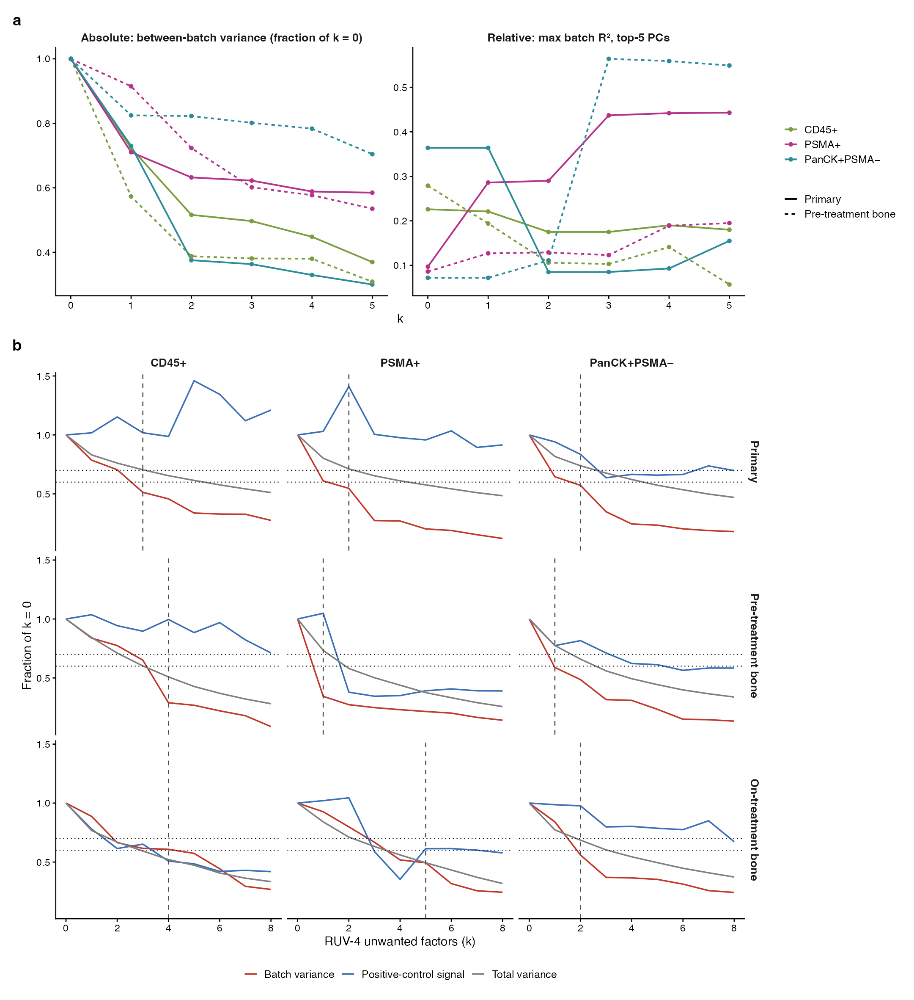

**Supplementary Fig. 5 | RUV-4 normalization: batch variance and selection of the number of unwanted factors (k).** **a**, Between-batch variance after RUV-4 with k = 0–5 unwanted factors, expressed as an absolute measure (fraction of between-batch variance at k = 0; left) and as the relative measure used earlier (maximum batch R² across the top five principal components; right), for primary (solid) and pre-treatment bone (dashed) strata; colour, compartment (green, CD45⁺; magenta, PSMA⁺; teal, PanCK⁺PSMA⁻). Absolute batch variance falls in every stratum, so the apparent failure of correction in PSMA⁺ AOIs is an artefact of the relative measure. **b**, Selection of k in each of the nine compartment × timepoint strata (rows: primary, pre-treatment bone, on-treatment bone): batch variance (red), positive-control signal (blue) and total variance (grey), each as a fraction of the value at k = 0; dashed vertical line, chosen k; dotted lines, 0.6 and 0.7 reference levels.

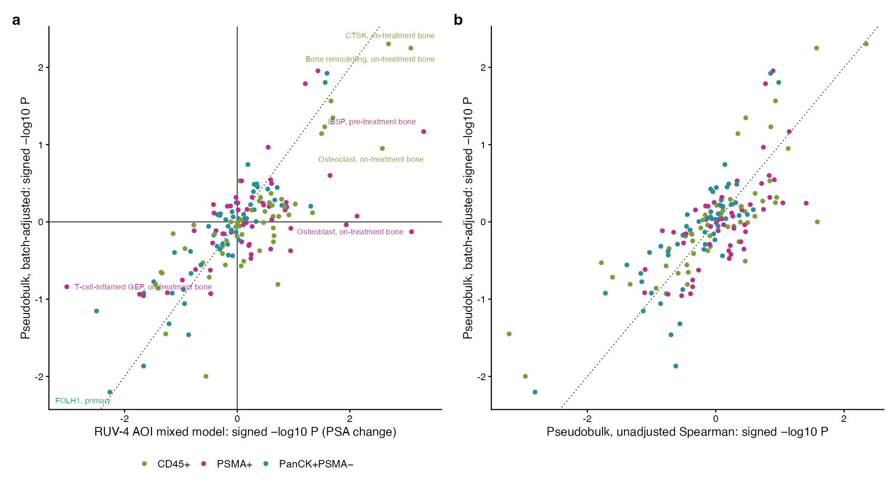

**Supplementary Fig. 6 | AOI-level RUV mixed models versus patient pseudobulk for pre-specified features.** Each point is one of 160 feature × stratum tests of association with maximal PSA change, coloured by compartment (green, CD45⁺; magenta, PSMA⁺; teal, PanCK⁺PSMA⁻); values are signed −log₁₀ P (positive, higher with worse response); dotted line, identity. **a**, AOI-level mixed model on RUV-4-normalized data versus batch-adjusted patient pseudobulk: effects have the same direction but are weaker in pseudobulk (Spearman ρ = 0.73); the most discordant features are labelled by feature and stratum (primary, pre-treatment bone or on-treatment bone; bone remodelling, bone-remodelling module; NEPC signature, neuroendocrine prostate cancer up-regulated genes). **b**, Unadjusted versus batch-adjusted patient pseudobulk: batch adjustment attenuates several associations because one sequencing batch contains all intermediate patients and two of five non-responders.

## Supplementary Tables and Data

**Supplementary Tables** (Supplementary_Tables_v6.xlsx; each sheet is captioned in row 1): clinical data and sample availability; LOQ gene universes; patient-level feature tests; transcriptome-wide results; paired on-treatment change; deconvolution comparison; reconciliation of earlier analyses; external signatures; standR arm and calibration; AOI-level arm (transcriptome-wide counts, permutation calibration, concordance, feature mixed models, on-treatment change); primary-to-bone analysis (programmes, Owen et al. markers, quality controls, AOI level, *CD276* associations, response associations); tissue–PET–ctDNA integration; AOI-level models with between- and within-patient purity terms (S75–S77); radiobiology panel (S78–S79); Bayesian hierarchical pooling (S80–S82); patient-selection models, decision curve and sample size (S83–S85); tumour burden, ctDNA categories, PET × tissue stratification, genotype–phenotype, transcriptional shift and prognostic factors (S86–S95); categorical non-responder versus responder AOI-level models (S96–S97); AOI-level models with a feature-free deconvolved tumour fraction (S98); patient pseudobulk *FOLH1* adjusted for AOI signal depth (S99); technical confounding: library size, read depth, saturation, background, signal depth, AOI number and slide-processing experiment versus response, adjusted features, adjusted induction, transcriptome-wide models and principal components (S100); on-treatment change of immune-microenvironment programmes, genes and deconvolved fractions (S101); STAMPEDE transcriptome signatures (Grist et al.) scored in PRINCE (S102); pre-treatment *FOLH1* versus on-treatment response, within-ROI and mediation analyses (S103); morphometric PSMA⁺ tumour share and nuclei-adjusted *FOLH1* (S104).

**Supplementary Data:** 1, per-stratum gene-level results (patient pseudobulk and AOI level); 2, primary-to-bone gene-level results; 3, per-AOI deconvolution fractions (SpatialDecon and BayesPrism); 4, per-AOI and per-patient programme scores; 5, gene-set definitions, including the PCCAT-derived NEPC signature and the Owen et al. marker programmes.
